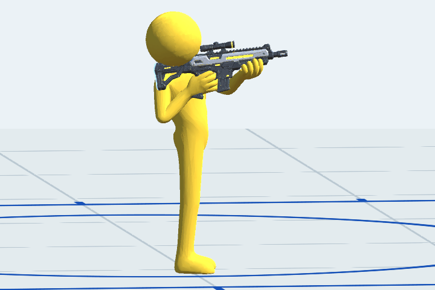

# DeathWish Unity Client

[게임 서버](https://github.com/BaeJiwoo/deathwish-server) · **Unity 클라이언트** · [게임 에셋](https://github.com/BaeJiwoo/deathwish-assets)

DeathWish 게임 서버에 접속해 방 입장, 3인칭 이동, 점프와 레이캐스트를 확인하는 Unity PC 클라이언트입니다. 클라이언트는 입력을 전송하고 서버 스냅숏을 화면에 표시합니다. 이동·충돌·명중 판정은 게임 서버에서 처리합니다.

## AR 조준·보행·사격 테스트



로컬 TCP 서버에 접속한 Unity에서 원격 Bob을 촬영했습니다. Bob은 에셋 저장소의 AR 소총을 오른손으로 쥐고 왼손으로 앞부분을 받칩니다. 제자리에서 시선을 옮기거나 옆으로 이동해도 총구는 카메라 방향을 따릅니다. 좌클릭하면 ShooterPack의 `idle aiming.fbx` 상체 자세에 짧은 반동을 합성합니다. 같은 방의 다른 플레이어에게도 발사가 보이고, 하체는 서버의 보행 주기로 `walk forward.fbx`를 계속 재생합니다.

## 빠른 실행

다른 플레이어의 이동을 확인하려면 두 클라이언트를 같은 서버의 같은 방에 접속시키세요.

1. **서버** 저장소 루트에서 아래 PowerShell 명령을 실행하고 `Listening on` 로그를 확인합니다. 서버에는 .NET 10 SDK가 필요합니다. 카메라 조준 테스트 기준 브랜치는 양쪽 모두 `codex/server-authoritative-animation`입니다.

   ```powershell
   $env:SERVER_ROOM_COUNT = '2'
   dotnet run --project src/DeathWish.Server -- 127.0.0.1 17779
   ```

2. **Unity Hub**에서 이 저장소의 루트 폴더를 **6000.3.11f1**로 엽니다. [SyncTestScene](Assets/DeathWishMovement/Scenes/SyncTestScene.unity)을 열고 **Play**를 누릅니다.
3. **Game** 뷰에서 Host `127.0.0.1`, Port `17779`, Room `2`로 **Connect and join**을 누릅니다. `Connected | PhysicsLab`과 증가하는 Tick을 확인한 뒤 **Capture input**을 누릅니다.

| 조작 | 확인할 결과 |
| --- | --- |
| WASD / 마우스 이동 | 카메라 방향 기준 이동 / 시점 회전 |
| Q / 설정 패널의 **Shoulder** | 좌우 어깨 전환. 기본 오른쪽 어깨에서는 캐릭터가 화면 왼쪽에 보이며, 선택은 재실행 후에도 유지됨 |
| Space | 지면에서 한 번 점프. **My server position (m)**의 Y가 올랐다가 착지하며 내려옴 |
| 마우스 좌클릭 | 서버 응답을 받으면 캐릭터 앞에서 탄 궤적이 뻗습니다. 지형 명중은 주황색, 플레이어 명중은 붉은색 링으로 표시합니다. 판정과 거리는 화면 하단과 Unity Console에서 확인합니다. |
| Esc → **Side / Height / Back (m)** | 어깨 좌우 간격·카메라 높이·뒤쪽 거리를 미터 단위로 입력합니다. Enter 또는 다른 필드를 누르면 값을 적용하고 저장합니다. |
| Esc / Disconnect | 커서 해제 / 방에서 나가고 연결 종료 |

## 저장소 구조

| 경로 | 역할 |
| --- | --- |
| [Assets/DeathWishMovement](Assets/DeathWishMovement) | 씬, 입력·화면 갱신을 담당하는 `SyncTestClient.cs`, 통신·프로토콜 DLL |
| [Resources](Assets/DeathWishMovement/Resources) | PhysicsLab 지형 데이터와 화면 표시용 셰이더 |
| [Packages](Packages) · [ProjectSettings](ProjectSettings) | uGUI 의존성, 에디터 버전, 입력 및 빌드 설정 |
| [테스트 가이드](docs/Testing.md) | MockClient와 동시 접속, 점프·레이캐스트 확인, DLL 갱신과 문제 해결 |
| [개발 규칙](AGENTS.md) · [개발 기록](docs/devlog/README.md) | 씬·연동 파일 변경 규칙과 날짜별 작업 내역 |
